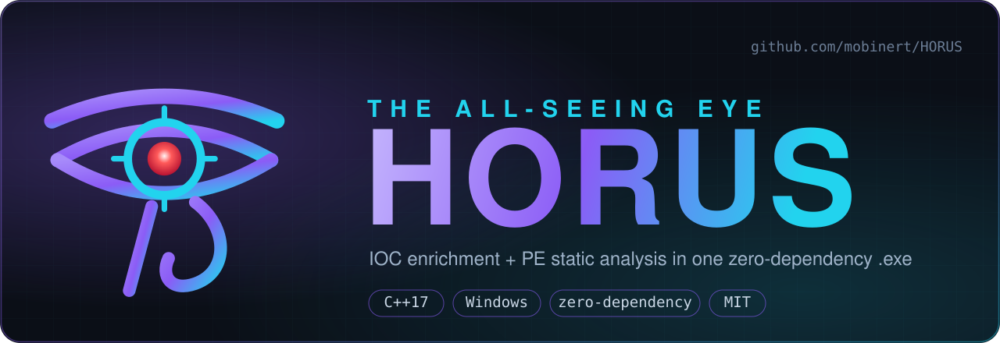

<div align="center">



<br/>


[](https://mobinert.github.io/HORUS/)

<br/>

```
  _   _  ___  ____  _   _ ____
 | | | |/ _ \|  _ \| | | / ___|
 | |_| | | | | |_) | | | \___ \
 |  _  | |_| |  _ <| |_| |___) |
 |_| |_|\___/|_| \_\\___/|____/

  🔱 the all-seeing eye  —  IOC enrichment & PE static analysis
```

<br/>

**Drop it anywhere. Point it at anything. Get a verdict.**

[**Download horus.exe**](https://github.com/mobinert/HORUS/releases/latest) · [View Source](#architecture) · [Quick Start](#quick-start) · [Usage Guide](#full-usage-guide)

</div>

---

## What is Horus?

Horus is a **single-file Windows security triage tool** — no Python, no installers, no dependencies. It links only against APIs that already ship with Windows (`BCrypt` for hashing, `WinHTTP` for HTTPS) and compiles down to one self-contained `.exe`.

Ships in three flavours from one engine — pick whichever fits your box:

| Binary | What it is |
|---|---|
| `horus-cli.exe` | the pure command line, zero third-party dependencies |
| `horus-gui.exe` | drag a file on it and get a **glass-console** report in your browser |
| `horus.exe` | both — CLI by default, `--gui` (or a double-click) opens the GUI |

Hand it **anything** and it figures out what to do:

| You give it | What Horus does |
|---|---|
| A file path | Hashes and inventories any file; valid PEs also get parsing, signature checks, capabilities, ATT&CK, UEBA, and a scored verdict |
| An MD5, SHA-1, or SHA-256 | Classifies it locally; `--enrich` queries VirusTotal |
| An IP address | Classifies it locally; `--enrich` queries VirusTotal + AbuseIPDB in parallel |
| A domain or URL | Classifies it locally; `--enrich` queries VirusTotal |
| An email address | Recognises the indicator and reports `UNKNOWN` unless a configured provider supports it |
| A samples directory | `--case` creates or refreshes a persistent, portable analysis workspace |

Direct file analysis needs no mode flag: `horus.exe sample.exe` runs immediately. Network access is always opt-in through `--enrich`.

### New in v4.0

- **Persistent Case Mode** — analyze up to 5,000 files with incremental refresh, `--verify`, `--rebuild`, `--prune`, portable relative paths, and atomic state.
- **Explainable similarity clusters** — exact SHA-256 duplicates for every file; valid PEs can be related by TLSH, imphash, Rich hash, and section layout. Results are similarity clusters, not definitive malware-family attribution.
- **Offline case dashboard** — searchable HTML plus `case.json`, `samples.csv`, `clusters.csv`, and `iocs.csv`; no server or CDN is required.
- **Safer verdict semantics** — non-PE inventory and incomplete analysis now return `UNKNOWN` with a nullable score instead of a false `CLEAN`.
- **Opt-in enrichment** — only hashes and extracted indicators are sent when `--enrich` is present. Samples are never uploaded.
- **Hardened I/O** — Base64 report embedding, safe DOM rendering, strict JSON parsing, 16 MiB HTTP responses, atomic writes, and CSV formula protection.
- **Windows 10/11 x64 release checks** — centralized version metadata, SHA-256 checksums, and GitHub artifact attestations for all release assets.

### New in v3.0

- **Glass console (GUI)** — a self-contained, glassmorphism report that renders in the browser: a risk ring, a live force-directed **threat graph** (sample → capabilities → ATT&CK → embedded IOCs), and a **MITRE ATT&CK heatmap** that lights up the techniques it found. No CDN or browser runtime dependency; network enrichment remains opt-in. `horus-gui.exe`, `horus --gui`, or `horus --html report.html` to export one.
- **Batch / folder scan** — `horus --scan <dir>` walks a directory, scores every file, prints a worst-first table, and dumps `--csv` / `--json-out` for a ticket.
- **PE diff** — `horus --diff a.exe b.exe`: imphash, rich-hash, section-entropy drift, and TLSH distance side by side. Compare related samples without uploading either file.
- **Config file + intel cache** — drop keys and a `cache_ttl_hours` in `~/.horus.json`; repeat VT/AbuseIPDB lookups come back instantly and don't burn quota.
- **Clipboard input** — `horus --clip` grabs whatever indicator you already copied.

### New in v2.1

- **Similarity hashing** — **TLSH** and **ssdeep** digests (byte-for-byte compatible with the reference tools), so you can compare related samples instead of only scoring them in isolation. Plus the **authentihash** (matches signed-malware campaigns) and the **rich hash** (MSVC build fingerprint).
- **Real Authenticode verification** — not just "a certificate is present." Runs the signature through `WinVerifyTrust` (embedded **and** catalog), pulls the signer's common name out of the PKCS#7, and flags anything that carries a certificate but no longer verifies as a tamper/forgery signal.
- **MITRE ATT&CK mapping** — every capability finding is tagged with its technique ID (`T1055`, `T1056.001`, `T1071`…) in both the console report and the JSON.
- **More of the PE** — Rich header decode, CodeView **PDB path** + GUID (attribution goldmine), **TLS callbacks**, exports, appended **overlay** (size + entropy), and **.NET/CLR** detection.

---

## Terminal Preview

```
  _   _  ___  ____  _   _ ____
 | | | |/ _ \|  _ \| | | / ___|
 | |_| | | | | |_) | | | \___ \
 |  _  | |_| |  _ <| |_| |___) |
 |_| |_|\___/|_| \_\\___/|____/
  🔱 the all-seeing eye  —  IOC enrichment & PE static analysis

$ horus ransomware_sample.exe --enrich

FILE ────────────────────────────────────────────────────────────
  path              ransomware_sample.exe
  size              102,912 bytes
  MD5               a3f5d1e2c7b849d60e14a2b8f93c5d17
  SHA-1             4b2e8a91c3d056f7e820b4a19c6d3f7e2b085c40
  SHA-256           e3b0c44298fc1c149afbf4c8996fb924...852b855

PE HEADER ───────────────────────────────────────────────────────
  type              executable
  bitness           64-bit (PE32+)
  machine           x64 (AMD64)
  subsystem         Windows Console
  compiled          2018-11-06 22:28:12 UTC  (suspicious)
  entry RVA         0x12a0
  imphash           9a4f2c8d1e7b3056a82c914d6e0f5b17

SECTIONS ────────────────────────────────────────────────────────
  .text     r-x  H=6.21  [##########........]
  .rdata    r--  H=4.87  [########..........]
  .data     rw-  H=4.12  [#######...........]
  UPX0      rwx  H=7.94  [##################]  RWX!
  UPX1      rwx  H=7.81  [#################.]  RWX!

IMPORTS  (4 DLLs, 11 functions) ─────────────────────────────────
  KERNEL32.DLL  (6)
  ADVAPI32.DLL  (3)
  WS2_32.DLL    (2)

CAPABILITIES ────────────────────────────────────────────────────
  [Cryptography]         encrypts data — benign, or ransomware/payload packing
      CryptAcquireContextA  CryptGenKey  CryptEncrypt

  [Network Activity]     opens sockets or fetches remote content
      WSAStartup  connect

  [Persistence]          writes autostart keys or installs itself to survive reboot
      RegSetValueExA  RegCreateKeyExA

  ! Encryption combined with network I/O (exfil / ransomware pattern)  +12
  ! High-entropy section 'UPX0' (H=7.94) — likely packed/encrypted     +12
  ! Section 'UPX0' is writable AND executable (RWX)                     +18
  ! Section 'UPX1' is writable AND executable (RWX)                     +18
  ! Known packer section name 'UPX0'                                    +16

EMBEDDED INDICATORS  (from strings) ────────────────────────────
  url    http://185.220.101.5:8080/gate.php
  ip     185.220.101.5
  tokens  cmd.exe  schtasks  powershell

THREAT INTELLIGENCE ─────────────────────────────────────────────
  VirusTotal  61/72 — Ransom.FileCryptor.Generic (Malicious)

VERDICT ─────────────────────────────────────────────────────────
  [ LIKELY MALICIOUS ]   risk 98/100
  static analysis: LIKELY MALICIOUS (86)
  virustotal: 61/72 engines
```

---

## How the Risk Score Works

Horus doesn't just list imports — it interprets them. The scoring engine maps ~110 Windows APIs to the capabilities they imply, then weights the **combinations** that matter:

### Individual Capabilities

| Capability | What it means | Score |
|---|---|---|
| Process Injection | `VirtualAllocEx`, `WriteProcessMemory`, `CreateRemoteThread` | **+22** |
| Input Capture (Keylogger) | `SetWindowsHookEx`, `GetAsyncKeyState`, `RegisterRawInputDevices` | **+20** |
| Persistence | `RegSetValueEx`, `CreateService` | **+14** |
| Privilege Escalation | `AdjustTokenPrivileges`, `DuplicateTokenEx`, `ImpersonateLoggedOnUser` | **+14** |
| Screen Capture | `BitBlt`, `GetDC`, `CreateCompatibleBitmap` | **+12** |
| Defense Evasion | `DeleteFile`, `SetFileAttributes`, `EventWrite` | **+12** |
| Networking | Winsock + WinHTTP + WinInet | **+8** |
| Cryptography | `CryptEncrypt`, `BCryptEncrypt`, `CryptGenKey` | **+8** |
| RWX Section | Writable **and** executable section | **+18 each** |
| High-entropy section | Shannon entropy ≥ 7.2 bits (packed/encrypted) | **+12 each** |
| Known packer name | UPX, Themida, VMProtect, .enigma, .vmp… | **+16** |

### Combination Bonuses (the important part)

| Combination | Why it matters | Bonus |
|---|---|---|
| **Injection + API resolution** | Hiding injected code behind dynamic imports | **+15** |
| **Keylogger + networking** | Classic keylogger-and-exfil architecture | **+15** |
| **Crypto + networking** | Ransomware or C2 exfiltration pattern | **+12** |

Common dual-use APIs (`LoadLibrary`, `CreateProcess`, `GetProcAddress`) are shown but **don't add to the score alone** — they show up in ordinary binaries all the time. Only rare primitives and dangerous combinations move the needle.

### Verdict Bands

| Score | Verdict | Meaning |
|---|---|---|
| 0–9 | **CLEAN** | Nothing concerning found |
| 10–29 | **LOW RISK** | Suspicious imports but no strong signals |
| 30–59 | **SUSPICIOUS** | Multiple concerning capabilities or combos |
| 60–100 | **LIKELY MALICIOUS** | Strong evidence of malicious intent |
| — | **UNKNOWN** | No scoreable evidence, or analysis was skipped/incomplete |

---

## Quick Start

### 1. Download (no install needed)

Grab `horus.exe` from [**Releases**](https://github.com/mobinert/HORUS/releases/latest) and put it somewhere on your PATH — or just run it from any folder.

```powershell
# Run from wherever you downloaded it
.\horus.exe suspicious.exe
```

### 2. Set API Keys (optional but recommended)

Horus works without keys — it still does full local PE analysis and hashing. Keys configure providers; `--enrich` explicitly enables live lookups for that run.

```powershell
# Set for this session
$env:VT_API_KEY        = "your_virustotal_key"
$env:ABUSEIPDB_API_KEY = "your_abuseipdb_key"

# Or make them permanent (user profile)
[System.Environment]::SetEnvironmentVariable("VT_API_KEY","your_key","User")
[System.Environment]::SetEnvironmentVariable("ABUSEIPDB_API_KEY","your_key","User")
```

Free API keys:
- **VirusTotal** → [virustotal.com](https://www.virustotal.com) → Sign in → API Key
- **AbuseIPDB** → [abuseipdb.com](https://www.abuseipdb.com) → Account → API

---

## Full Usage Guide

```
horus <indicator-or-file> [options]
horus --case <samples-dir> [case options]

  <indicator-or-file>   anything: a file path, hash, IP, domain, URL, or email

options:
  --case <dir>          create or refresh a persistent analysis case
  --case-out <dir>      workspace (default: <dir>.horus-case)
  --case-name <name>    analyst-facing case name
  --cluster-mode <m>    conservative, balanced, or broad
  --verify              re-hash cached case files before reuse
  --rebuild             repeat all case analysis
  --prune               remove missing files from case history
  --enrich              query configured providers; files are never uploaded
  --max-lookups <n>     live lookup cap (default: 100)
  --max-file-mb <n>     per-file limit (default: 512 MiB)
  --no-recurse          analyze only the top level of a case directory
  --online-trust        allow online Authenticode revocation checks
  --scan <dir>          triage every file in a folder, worst-first
  --diff <a> <b>        compare two PEs (imphash / TLSH / section entropy)
  --clip                read the indicator from the clipboard
  --gui                 open the glass-console GUI (unified build)
  --html <file>         write the glass-console report to an HTML file
  --csv <file>          with --scan, also write a CSV
  --json-out <file>     with --scan, also write a JSON array
  --cache-ttl <hours>   cache intel lookups for N hours (0 = off)
  --vt-key    <key>     VirusTotal API key      (overrides VT_API_KEY env)
  --abuse-key <key>     AbuseIPDB API key        (overrides ABUSEIPDB_API_KEY env)
  --strings             dump extracted ASCII/UTF-16 strings from the file
  --profile             verbose UEBA signal breakdown
  --json                machine-readable JSON output (exit code 1 = suspicious/malicious)
  --no-color            disable ANSI colour (auto-disabled when piped)
  -h, --help            show this help
  --version             print the version
```

A `~/.horus.json` is read if present, so you don't paste keys every run:

```json
{ "vt_key": "…", "abuse_key": "…", "cache_ttl_hours": 24 }
```

### File Analysis Examples

```bat
:: Static analysis of a suspicious binary (PE parser + entropy + capabilities)
horus C:\Samples\malware.exe

:: Same, plus hash and embedded-IOC reputation
horus C:\Samples\malware.exe --enrich --vt-key %VT_API_KEY%

:: Analyze and dump its full string table
horus C:\Samples\dropper.dll --strings

:: Get machine-readable JSON for scripting or SIEM ingestion
horus C:\Samples\payload.bin --json

:: Pipe JSON output into jq to extract just the verdict
horus suspicious.exe --json | jq .verdict
```

### Persistent Case Mode

```powershell
# Creates C:\Cases\incoming.horus-case and recursively analyzes up to 5,000 files
horus.exe --case C:\Cases\incoming

# Re-check every cached hash, enable provider lookups, and open the offline dashboard
horus.exe --case C:\Cases\incoming --verify --enrich --gui

# Rebuild all analysis with the strictest similarity preset
horus.exe --case C:\Cases\incoming --rebuild --cluster-mode conservative
```

Each workspace contains private state under `.horus` and portable exports named `case.json`, `report.html`, `samples.csv`, `clusters.csv`, and `iocs.csv`. Stored paths are relative to the samples directory.

### IOC Lookup Examples

```bat
:: MD5, SHA-1, or SHA-256 hash — Horus auto-detects the type
horus 44d88612fea8a8f36de82e1278abb02f --enrich
horus 3395856ce81f2b7382dee72602f798b642f14d0 --enrich
horus 275a021bbfb6489e54d471899f7db9d1663fc695b2cfad87ef3ef... --enrich

:: IP reputation from VirusTotal + AbuseIPDB simultaneously
horus 185.220.101.5 --enrich

:: Domain reputation
horus evil-c2-domain.ru --enrich

:: Full URL
horus https://sketchy.example/drop.bin --enrich

:: Email address
horus attacker@phishing-domain.com --enrich

:: Combine keys inline instead of via env vars
horus 1.2.3.4 --enrich --vt-key abc123 --abuse-key def456

:: JSON output for automation
horus 185.220.101.5 --enrich --json
```

### Scripting / Automation

Exit codes make Horus useful in pipelines:

| Exit code | Meaning |
|---|---|
| `0` | Analysis completed and no score reached 30 |
| `1` | Suspicious or malicious — score ≥ 30 |
| `2` | Fatal error, usage error, or output failure |
| `3` | `UNKNOWN`, skipped, or otherwise incomplete, with no score ≥ 30 |

```powershell
# Block a file from being used if Horus flags it
horus .\download.exe --json | Out-Null
if ($LASTEXITCODE -eq 1) {
    Write-Warning "File flagged — not running it."
    exit 1
}

# Batch-triage a folder
Get-ChildItem C:\Quarantine\*.exe | ForEach-Object {
    $result = horus $_.FullName --json | ConvertFrom-Json
    "$($_.Name): $($result.verdict) (score $($result.final_score))"
}
```

### JSON Output Format

```json
{
  "target":       "malware.exe",
  "analysis_status": "complete",
  "size":          102912,
  "md5":          "a3f5d1e2c7b849d60e14a2b8f93c5d17",
  "sha1":         "4b2e8a91c3d056f7e820b4a19c6d3f7e2b085c40",
  "sha256":       "e3b0c44298fc1c149afbf4c8996fb92427ae41e4649b934ca495991b7852b855",
  "is_pe":         true,
  "bitness":       64,
  "imphash":      "9a4f2c8d1e7b3056a82c914d6e0f5b17",
  "static_score":  86,
  "vt_detections": 61,
  "final_score":   98,
  "verdict":      "LIKELY MALICIOUS"
}
```

For a non-PE file with no provider evidence, `analysis_status` is `unknown`, `final_score` is `null`, and `verdict` is `UNKNOWN`.

---

## Architecture

No external libraries. No runtime dependencies. Everything in one `.exe`.

```
horus/
│
├── src/
│   ├── main.cpp          unified CLI/GUI entry point
│   ├── core.hpp          shared direct-analysis pipeline and report models
│   ├── case.hpp          persistent case refresh and enrichment workflow
│   ├── cluster.hpp       duplicate grouping and explainable PE similarity
│   ├── case_io.hpp       portable case state and HTML/CSV/JSON exports
│   ├── pe.hpp            PE32 / PE32+ parser — every field bounds-checked
│   ├── signatures.hpp    110-API knowledge base + capability scoring engine
│   ├── attack.hpp        capability → MITRE ATT&CK technique mapping
│   ├── ueba.hpp          behavioral archetype profiling
│   ├── fuzzy.hpp         TLSH + ssdeep similarity hashing (self-contained)
│   ├── authenticode.cpp/hpp  signature verification (WinVerifyTrust + crypt32)
│   ├── ioc.hpp           indicator type auto-detection (no regex, hand-rolled)
│   ├── json.hpp          zero-dependency JSON parser (recursive descent)
│   ├── crypto.cpp/hpp    MD5 / SHA-1 / SHA-256 / authentihash via BCrypt/CNG
│   ├── http.cpp/hpp      HTTPS client via Windows WinHTTP
│   ├── intel.cpp/hpp     VirusTotal v3 + AbuseIPDB v2 (extensible interface)
│   ├── output.hpp        atomic files and CSV cell hardening
│   └── console.hpp       ANSI colour / formatted terminal output
│
├── tests/
│   ├── test_ioc.cpp      indicator classifier unit tests
│   ├── test_json.cpp     JSON parser unit tests
│   ├── test_pe.cpp       PE parser unit tests
│   ├── test_fuzzy.cpp    TLSH / ssdeep unit tests
│   ├── test_score.cpp    risk scoring engine unit tests
│   ├── test_case.cpp     refresh, duplicate, clustering, and 5,000-record benchmark
│   └── direct_smoke.ps1  process-level direct mode and exit-code checks
│
├── CMakeLists.txt        CMake build (MSVC or MinGW-w64)
└── LICENSE
```

### Internal Data Flow

```
horus <argument>
       │
       ├─ --case? ──YES──► refresh persistent workspace + cluster + export
       │
       ├─ file_exists(arg)? ──YES──► analyze_file()
       │                                │
       │                                ├─ read bytes
       │                                ├─ hash_buffer()   ← BCrypt/CNG
       │                                ├─ pe::Analyzer::analyze()
       │                                │     ├─ parse headers (bounds-checked)
       │                                │     ├─ parse sections + entropy
       │                                │     ├─ parse import table
       │                                │     └─ build imphash string
       │                                ├─ sig::score()    ← capability engine
       │                                ├─ extract_strings() → scan_strings()
       │                                └─ hash / IOC lookup (only with --enrich)
       │
       └─ NO ──► classify(arg)
                     │
                     └─► intel::enrich()  ← only with --enrich; parallel fan-out
                               ├─ VirusTotal::lookup()   (if supported + key)
                               └─ AbuseIPDB::lookup()    (if supported + key)
```

### Adding a New Intel Source

The `IntelSource` interface is three methods. One new file, one new line in `build_sources()`:

```cpp
// In intel.cpp — add this class
class URLhaus : public IntelSource {
public:
    explicit URLhaus(std::string key) : key_(std::move(key)) {}
    std::string name() const override { return "URLhaus"; }
    bool supports(IocType t) const override {
        return t == IocType::Url || t == IocType::Domain;
    }
    SourceResult lookup(const std::string& ioc, IocType) const override {
        // one WinHTTP call → parse JSON → fill SourceResult
    }
private:
    std::string key_;
};

// In main.cpp — build_sources(), add one line:
if (!o.urlhaus_key.empty()) v.push_back(std::make_shared<URLhaus>(o.urlhaus_key));
```

Candidate sources to add: URLhaus · OTX (AlienVault) · GreyNoise · Shodan · MalwareBazaar

---

## Building from Source

**Requirements:** Windows 10/11 x64, Visual Studio 2022 with the Desktop C++ workload, and CMake 3.15 or newer.

### Build with CMake

```bat
git clone https://github.com/mobinert/HORUS.git
cd HORUS
cmake -S . -B build -G "Visual Studio 17 2022" -A x64 -DBUILD_TESTING=ON
cmake --build build --config Release
:: binaries at build\Release\ :  horus-cli.exe  horus.exe  horus-gui.exe
```

### Running the tests

The unit tests are wired into CTest:

```bat
cmake -B build -G "Visual Studio 17 2022" -A x64
cmake --build build --config Release
ctest --test-dir build -C Release --output-on-failure
```

Covers direct PE and non-PE analysis, paths with spaces, Case Mode refresh/rebuild/prune,
all three clustering presets, stable split/merge IDs, the 5,000-record benchmark,
report injection, strict JSON, bounded HTTP responses, atomic output, version metadata,
and exit codes. Provider behavior uses an in-memory mock; the test suite never calls live services.

### Verify a release download

```powershell
Get-FileHash .\horus.exe -Algorithm SHA256
gh attestation verify .\horus.exe -R mobinert/HORUS
```

Compare the first command with `SHA256SUMS.txt`. Release binaries are currently
Authenticode-unsigned, so Windows may still show a reputation warning; the checksum and
GitHub attestation verify the file's integrity and build provenance.

---

## Imphash

The imphash follows the Mandiant recipe: lowercase `dll.function` pairs (with extension stripped for `.dll`, `.ocx`, `.sys`), joined by commas in import order, then MD5'd. This matches what tools like `pefile` and `pe-sieve` produce, so you can cross-reference Horus results with existing sample collections.

---

## Safety and Limitations

- Horus never executes, copies, modifies, or uploads a sample. It only writes requested reports, case state, and local cache files.
- The PE parser **bounds-checks every offset and length** before reading. Feeding it a malformed or malicious sample is safe.
- Network access is off by default. `--enrich` sends only hashes and extracted indicators to configured providers; `--online-trust` separately enables online certificate revocation checks.
- The static risk score is a **triage aid**, not a production verdict. Pair it with independent evidence and, for anything that matters, a controlled sandbox detonation.
- Obfuscated samples that load all their imports at runtime will score low on static analysis — that's expected. The entropy and packing heuristics partially compensate, but there's no substitute for dynamic analysis on heavily obfuscated code.

---

## More from the same workbench

| Tool | What it does |
|------|--------------|
| [**machunt**](https://github.com/mobinert/machunt) | Read-only macOS threat hunting & compromise assessment — 20 modules, HTML/JSON reports |
| [**ssh-fortress**](https://github.com/mobinert/ssh-fortress) | SSH hardening, brute-force protection & SIEM integration for Linux servers |

---

## License

MIT — see [LICENSE](LICENSE). Free for personal, commercial, and research use forever.

---

<div align="center">


**Built for defenders. Free forever. No strings attached.**

⭐ If Horus helped you, a star goes a long way

</div>
